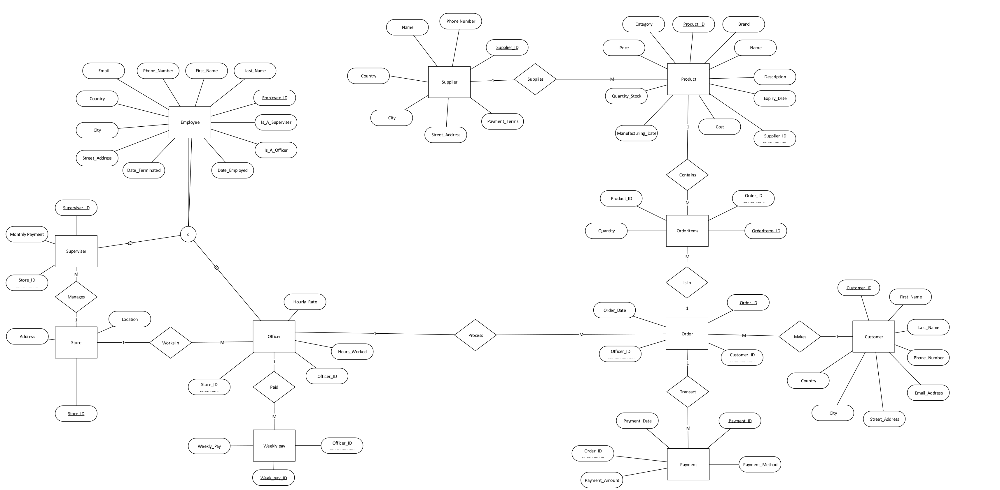

# Skincare Store Sales & Stock Database

A working sales and stock-keeping database, with forms and reports, for a small multi-store skincare business in Malawi.

## Business problem
The business tracked sales and stock the old, manual way, so the owner could not tell which products drove revenue or when to restock. I designed a database to track daily sales and stock and to support decisions on product performance, market trends, profitability and fraud control.

## What I built
- Normalised relational schema and ER diagram (see `docs/erd.pdf`, `docs/schema.pdf`).
- Tables created and populated with SQL statements (dummy data).
- Data-entry **forms** with a consistent look and feel, and **reports** such as top-selling product and sales over time.
- **Update queries** that adjust stock on every sale, with subtotal and total calculations.
- Per-user logins to support a maker/checker control against fraud.

## Repository contents
| Path | What it is |
|---|---|
| `docs/business-justification.pdf` | The business case: product performance, market understanding, profitability, fraud, efficiency |
| `docs/erd.pdf`, `docs/schema.pdf`, `docs/schema-description.docx` | Data model |
| `docs/evaluation.pdf` | Reflection: what went well, what didn't, what I'd change |
| `docs/presentation.pptx` | Presentation deck |

The Access database (`Skincare.accdb`, about 37 MB) is attached to the [Releases](../../releases) page.

## Lessons learned
Normalising the ER diagram properly up front would have saved most of my rework; I now plan the data model much more thoroughly before building. Access also could not be set to the Malawian kwacha, so currency shows as euro.

## Tools
Microsoft Access, SQL, ER modelling, normalisation.

## License
MIT, see [LICENSE](LICENSE).
